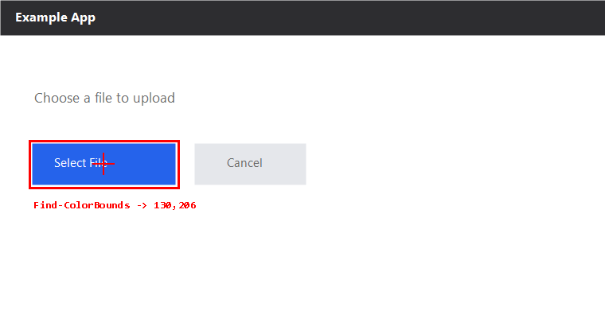

# mouse-and-eyes

**GUI automation from first principles — five primitives built directly on the Win32 API.**

Zero dependencies · Pure PowerShell · ~100 lines per file · MIT

---

> see → find → act → confirm
>
> Every GUI automation framework is built from these moves plus a handful of Win32 calls.
> This repo takes the casing off so you can see what's inside.

## What this is

A GUI automation implementation you can **actually read end to end**.

No `pip install`, no framework, no config files. If you have Windows and the built-in PowerShell, it runs.

```powershell
. .\win\Screen.ps1
. .\win\Find.ps1
. .\win\Input.ps1

$bmp = Get-ScreenBitmap
$hit = Find-ColorBounds -Bitmap $bmp -Color '#2563EB'   # locate the blue button
Invoke-Click -X $hit.CenterX -Y $hit.CenterY            # click it
$bmp.Dispose()
```

That's the whole thing — grab the screen, find a color, compute the center, click.

## What this is not

- ❌ Not a production framework. For stable business automation use [pywinauto](https://github.com/pywinauto/pywinauto) or a commercial RPA tool
- ❌ Cannot drive Chromium / Electron controls (their accessibility tree is empty — you're left with coordinate clicking)
- ❌ Does not do DPI scaling math (most accurate at 100%; see [docs/limits.md](docs/limits.md))

**Positioning: teaching + fallback.** When you can't figure out why some framework won't work, come here and look at the layer underneath.

---

## Result

A mock window as the target; `Find-ColorBounds` looks for that blue button (color `#2563EB`, tolerance 12). The red box and crosshair are what the algorithm computed:



```
found blue: 41,181 - 219,231  (8816 px)  center = 130,206
```

That center is where `Invoke-Click` would go. Three steps total:
**screenshot → find color, compute center → click**. No black boxes.

---

## The five primitives

| # | Primitive | File | What's underneath |
|---|-----------|------|-------------------|
| 1 | **see** | `win/Screen.ps1` | `GetDC` → `CreateCompatibleBitmap` → `BitBlt` |
| 2 | **find window** | `win/Window.ps1` | `EnumWindows` + `GetWindowRect` + `AttachThreadInput` |
| 3 | **find in pixels** | `win/Find.ps1` | `LockBits` for raw bytes, then pure in-memory scanning |
| 4 | **act** | `win/Input.ps1` | `SetCursorPos` / `mouse_event` / `SendInput` |
| 5 | **wait** | `win/Wait.ps1` | poll until a condition holds (never guess a sleep) |

Plus `win/Native.ps1`, which holds every P/Invoke declaration — if you want to know which Windows functions this repo uses, read that one file.

---

## Quick start

```powershell
git clone https://github.com/lizijoy/mouse-and-eyes.git
cd mouse-and-eyes

# 1) capture the screen and read the color under the cursor (safe, changes nothing)
powershell -ExecutionPolicy Bypass -File .\examples\01-screenshot.ps1

# 2) find a color on screen and report where it is (dry-run, does not click)
powershell -ExecutionPolicy Bypass -File .\examples\02-click-color.ps1

# 3) actually click (swap in your target button's color first)
powershell -ExecutionPolicy Bypass -File .\examples\02-click-color.ps1 -Color '#2563EB' -Execute

# 4) bring a window to the foreground and type Chinese text (opens its own Notepad as a target)
powershell -ExecutionPolicy Bypass -File .\examples\03-focus-and-type.ps1
```

> ⚠️ Example 3 steals focus, opens Notepad, types, then closes it. Skip it if that bothers you.

---

## Layout

```
mouse-and-eyes/
├── win/
│   ├── Native.ps1      every Win32 P/Invoke declaration (all the "magic" lives here)
│   ├── Screen.ps1      screen capture, window capture, pixel sampling
│   ├── Window.ps1      enumerate, find, focus, topmost, coordinate conversion
│   ├── Find.ps1        color bounding box, naive template matching
│   ├── Input.ps1       mouse, keyboard, Unicode input, clipboard
│   └── Wait.ps1        polling primitives
├── examples/
│   ├── 01-screenshot.ps1
│   ├── 02-click-color.ps1
│   └── 03-focus-and-type.ps1
├── docs/
│   ├── why.md          why hand-roll it, and how it relates to existing frameworks
│   ├── limits.md       when NOT to use this (read this first)
│   └── images/
├── LICENSE
└── README.md
```

---

## Three technical points worth calling out

### 1. Why foreground stealing needs `AttachThreadInput`

Windows doesn't let background processes raise their own windows. `SetForegroundWindow` will happily "return success" while nothing happens.

```powershell
# attach our thread to the foreground thread's input queue
AttachThreadInput($myThread, $fgThread, $true)
# now the OS treats us as the foreground thread's sibling and allows the switch
SetForegroundWindow($handle)
# detach immediately
AttachThreadInput($myThread, $fgThread, $false)
```

### 2. Unicode input must go through `SendInput`

`keybd_event`'s scan-code parameter is 8 bits, so it can't carry Unicode code points above 255. Non-ASCII text needs `SendInput` with `KEYEVENTF_UNICODE`, whose `wScan` is 16 bits.

### 3. Pixel scanning must use `LockBits`

`Bitmap.GetPixel` crosses the .NET boundary on every call. A 1920×1080 image has 2 million pixels — scanning it that way takes minutes.

`LockBits` copies the pixel memory into a `byte[]` once; after that it's a plain in-memory loop, two orders of magnitude faster:

```powershell
$data = $bmp.LockBits($rect, 'ReadOnly', 'Format32bppArgb')
Marshal::Copy($data.Scan0, $bytes, 0, $bytes.Length)
# now $bytes is BGRA BGRA BGRA ...
```

---

## Contributing

**Anyone is welcome to change this.** Especially:

- 🌍 **Other platforms** — macOS (CGEvent / CGWindowList), Linux (X11 / Wayland)
- 🐧 **Minimal implementations in other languages** — C, Rust, Go, Python. The convention: one file, zero dependencies, it runs
- 📖 **Failure modes missing from docs/limits.md** — a pit you fell into is a signpost for someone else

Only three rules:

1. It runs (include the OS version you verified on)
2. Keep dependencies at zero where possible
3. Write comments for someone seeing P/Invoke for the first time

Open a PR directly — no issue needed first.

---

## License

[MIT](LICENSE). Do whatever you want with it, no need to ask.
