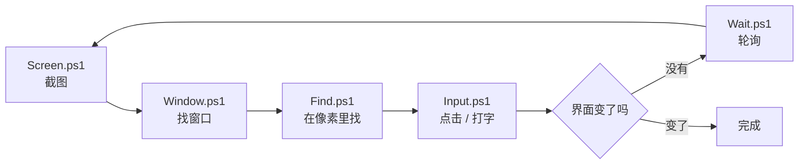

# 为什么手写这个

## 起因

我需要程序替我点一个按钮。试了几个库，要么装一大堆东西，要么出问题的时候完全不知道从哪查起。干脆自己按 Win32 写一遍，只有五个文件，每个一百行左右，出问题直接看源码。

写完之后觉得，可能有人也会想看看这一层。

## 五个原语怎么转

一个能跑的自动化动作就是这五步在转圈。最容易出错的是「等」那一步——写个 `Start-Sleep -Milliseconds 500` 然后指望界面在这半秒里加载完，十次里有三次会挂。

## 和现有项目的关系

不是替代，是底层参照。

| 项目 | 它做什么 | 和这里的关系 |
|------|---------|-------------|
| [pywinauto](https://github.com/pywinauto/pywinauto) | 把 UIA/MSAA 包成 Python 对象 | 这里只做 Win32 那层，原生控件还是用 pywinauto 好 |
| pyautogui | 截图 + 找图 + 点坐标 | 这里的找图基本就是它的手写简化版 |
| [microsoft/UFO](https://github.com/microsoft/ufo) | LLM 驱动的 Windows agent，混合 UIA 和视觉 | 重得多，适合直接干活 |
| [microsoft/OmniParser](https://github.com/microsoft/omniparser) | 把截图解析成结构化元素 | 视觉流派，这里的找色算史前版本 |
| [UI-TARS](https://github.com/bytedance/ui-tars) | 端到端 GUI 模型 | 终极方案，要算力 |

要做生产工具，去看上面这些。想搞懂它们凭什么能工作，读这里。

## 每个文件在干什么

- **Native.ps1** —— 所有 Win32 声明。想查这个仓库用了哪些系统函数，看这一个就够
- **Screen.ps1** —— `GetDC` → `CreateCompatibleBitmap` → `BitBlt`，就是「截图」的全部。OBS、ShareX 底下也是这个
- **Window.ps1** —— 窗口是棵树，`EnumWindows` 给你顶层。抢前台那段有点技巧，见注释
- **Input.ps1** —— 鼠标两步：定位、按下抬起。键盘有个坑，`keybd_event` 发不了中文，得用 `SendInput`
- **Find.ps1** —— 找色和找图。重点看为什么必须用 `LockBits`
- **Wait.ps1** —— 轮询，别猜时间

## 建议的读法

按 `Native.ps1` → `Screen.ps1` → `Window.ps1` → `Input.ps1` → `Find.ps1` → `Wait.ps1` 的顺序看。

每个文件都能单独拿走用。
